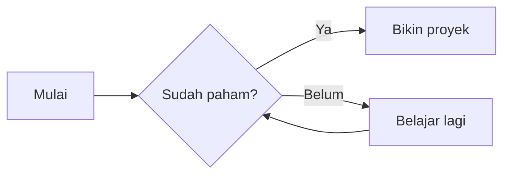
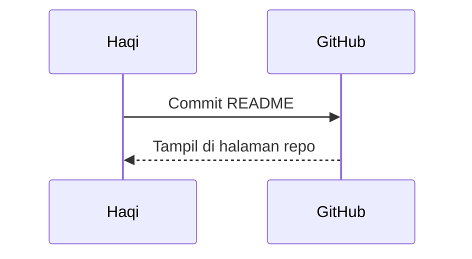
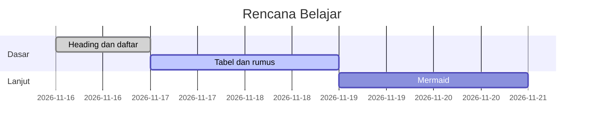
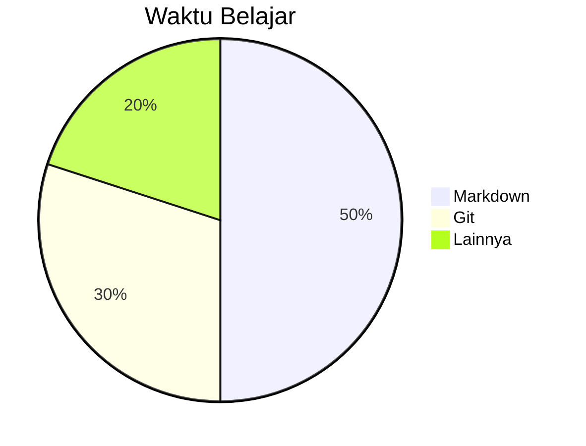
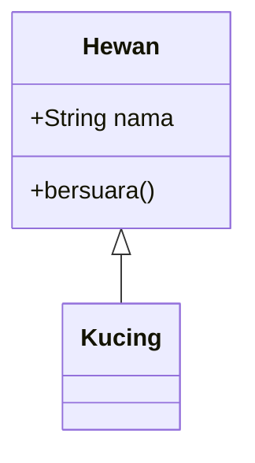

<h1 align="center">📘 Semua yang Bisa Dilakukan Markdown</h1>

<p align="center">
  
  
  
  
</p>

<p align="center"><i>Satu file, semua fitur. Commit lalu lihat hasilnya di halaman repo.</i></p>

---

## 📑 Daftar Isi

1. [Teks dan Format](#1-teks-dan-format)
2. [Heading](#2-heading)
3. [Daftar](#3-daftar)
4. [Checklist](#4-checklist)
5. [Link dan Gambar](#5-link-dan-gambar)
6. [Tabel](#6-tabel)
7. [Kode](#7-kode)
8. [Kutipan dan Alerts](#8-kutipan-dan-alerts)
9. [Rumus Matematika](#9-rumus-matematika)
10. [Diagram Mermaid](#10-diagram-mermaid)
11. [Bagian yang Bisa Dilipat](#11-bagian-yang-bisa-dilipat)
12. [Footnote](#12-footnote)
13. [HTML yang Didukung](#13-html-yang-didukung)
14. [Emoji](#14-emoji)
15. [Lain-lain](#15-lain-lain)

---

## 1. Teks dan Format

Teks biasa, **tebal**, *miring*, ***tebal dan miring***, ~~dicoret~~, dan `kode dalam baris`.

Teks dengan <sub>subscript</sub> seperti H<sub>2</sub>O dan <sup>superscript</sup> seperti x<sup>2</sup>.

Tombol keyboard: <kbd>Ctrl</kbd> + <kbd>C</kbd> untuk salin, <kbd>Ctrl</kbd> + <kbd>V</kbd> untuk tempel.

Teks <ins>bergaris bawah</ins> dan <mark>disorot</mark> (kadang tidak tampil di semua tempat).

Karakter spesial ditulis dengan backslash: \*bukan miring\*, \# bukan heading, \[bukan link\].

Baris baru dalam satu paragraf:  
akhiri baris dengan dua spasi atau tag `<br>`.<br>
Seperti ini.

---

## 2. Heading

# Heading 1
## Heading 2
### Heading 3
#### Heading 4
##### Heading 5
###### Heading 6

---

## 3. Daftar

**Daftar bertitik:**

- Apel
- Jeruk
  - Jeruk manis
  - Jeruk nipis
    - Nested lagi
- Mangga

**Daftar bernomor:**

1. Bangun tidur
2. Sarapan
3. Belajar Markdown
   1. Heading
   2. Tabel
   3. Rumus

**Campuran:**

1. Langkah pertama
   - Detail A
   - Detail B
2. Langkah kedua

---

## 4. Checklist

- [x] Belajar heading
- [x] Belajar daftar
- [x] Belajar rumus
- [ ] Belajar Mermaid
- [ ] Bikin website dengan GitHub Pages

---

## 5. Link dan Gambar

[Link biasa ke GitHub](https://github.com)

[Link dengan judul saat hover](https://github.com "Klik untuk ke GitHub")

Link otomatis: https://github.com

Link ke bagian lain di file ini: [Kembali ke Daftar Isi](#-daftar-isi)

Link gaya referensi: [Dokumentasi Markdown][docs]

[docs]: https://docs.github.com/en/get-started/writing-on-github

**Gambar:**


**Gambar yang bisa diklik:**

[](https://github.com)

**Gambar dengan ukuran diatur (HTML):**


---

## 6. Tabel

| Fitur | Didukung | Catatan |
|-------|:--------:|--------:|
| Tabel | ✅ | Rata tengah di kolom 2 |
| Rumus | ✅ | Rata kanan di kolom 3 |
| Warna teks | ❌ | Hanya lewat rumus |

Rata kiri `:---`, tengah `:---:`, kanan `---:`.

---

## 7. Kode

Kode dalam baris: `print("Halo")`

**Python:**

```python
def sapa(nama):
    return f"Halo, {nama}!"

print(sapa("Haqi"))
```

**JavaScript:**

```javascript
const jumlah = (a, b) => a + b;
console.log(jumlah(2, 3));
```

**HTML:**

```html
<h1>Halo Dunia</h1>
```

**Bash:**

```bash
git add .
git commit -m "belajar markdown"
git push
```

**Perubahan kode (diff):**

```diff
- baris yang dihapus
+ baris yang ditambah
```

**JSON:**

```json
{
  "nama": "Haqi",
  "belajar": "Markdown"
}
```

---

## 8. Kutipan dan Alerts

> Ini kutipan biasa.
>
> > Kutipan di dalam kutipan.

> [!NOTE]
> Informasi tambahan (biru).

> [!TIP]
> Saran berguna (hijau).

> [!IMPORTANT]
> Hal penting (ungu).

> [!WARNING]
> Peringatan (kuning).

> [!CAUTION]
> Bahaya atau risiko (merah).

---

## 9. Rumus Matematika

**Dalam kalimat:** rumus Einstein adalah $E = mc^2$ dan turunan sinus adalah $\frac{d}{dx}\sin x = \cos x$.

**Rumus kuadrat (ABC):**

$$
x = \frac{-b \pm \sqrt{b^2 - 4ac}}{2a}
$$

**Limit:**

$$
\lim_{x \to 0} \frac{\sin x}{x} = 1
$$

**Turunan:**

$$
f'(x) = \lim_{h \to 0} \frac{f(x+h) - f(x)}{h}
$$

**Integral:**

$$
\int_a^b f(x) \, dx = F(b) - F(a)
$$

**Deret:**

$$
\sum_{n=1}^{\infty} \frac{1}{n^2} = \frac{\pi^2}{6}
$$

**Matriks:**

$$
\begin{pmatrix}
a & b \\
c & d
\end{pmatrix}
$$

**Sistem persamaan:**

$$
\begin{cases}
x + y = 5 \\
x - y = 1
\end{cases}
$$

**Rumus berwarna:**

$$
\color{red}{a} + \color{orange}{b} + \color{#00bcd4}{c} + \color{purple}{d}
$$

**Tulisan berwarna cyan:**

$$
\color{cyan}{\text{I love you}}
$$

**Blok math (cara lain):**

```math
e^{i\pi} + 1 = 0
```

---

## 10. Diagram Mermaid

**Flowchart:**



**Diagram urutan:**



**Gantt chart:**



**Diagram pai:**



**Diagram kelas:**



---

## 11. Bagian yang Bisa Dilipat

<details>
<summary>Klik untuk lihat isinya</summary>

Isi tersembunyi di sini. Boleh berisi **format** apa saja:

- Daftar
- Kode: `halo`

```python
print("Rahasia terbuka!")
```

</details>

<details open>
<summary>Yang ini terbuka dari awal</summary>

Tambahkan atribut `open` supaya langsung terbuka.

</details>

---

## 12. Footnote

Markdown mendukung catatan kaki[^1] dan bisa lebih dari satu[^2].

[^1]: Ini isi catatan kaki pertama.
[^2]: Ini isi catatan kaki kedua.

---

## 13. HTML yang Didukung

<div align="center">

Teks ini rata tengah dengan `div align`.

</div>

<p align="right">Teks rata kanan.</p>

<table>
  <tr>
    <th>Kolom A</th>
    <th>Kolom B</th>
  </tr>
  <tr>
    <td>Tabel HTML</td>
    <td>Bisa gabung sel (<code>colspan</code>)</td>
  </tr>
</table>

<details>
<summary>Catatan</summary>

Tag `<script>`, `<style>`, dan atribut `style="color:red"` dihapus GitHub demi keamanan, jadi warna teks bebas tidak bisa.

</details>

---

## 14. Emoji

Pakai kode: :smile: :rocket: :fire: :heart: :tada: :books: :bulb: :white_check_mark:

Atau langsung: 😀 🚀 🔥 ❤️ 🎉 📚 💡 ✅

Penanda warna: 🔴 🟠 🟡 🟢 🔵 🟣 🟤 ⚫ ⚪

---

## 15. Lain-lain

**Garis pemisah** (tiga strip, bintang, atau garis bawah):

---

***

___

**Komentar tersembunyi** (tidak tampil di halaman):

<!-- Ini komentar, hanya terlihat saat mengedit file -->

**Mention dan referensi** (aktif di issue dan pull request): `@HaqiKuy470`, `#1`.

**Pohon folder dengan blok kode:**

```
ProgramMarkdown/
├── README.md
├── Semua-Markdown.md
└── gambar/
    └── logo.png
```

**Daftar definisi memakai HTML:**

<dl>
  <dt>Markdown</dt>
  <dd>Bahasa penulisan teks yang sederhana dan mudah dibaca.</dd>
</dl>

---

<p align="center">
  Dibuat untuk belajar Markdown 💙<br>
  <a href="#-semua-yang-bisa-dilakukan-markdown">⬆ Kembali ke atas</a>
</p>
